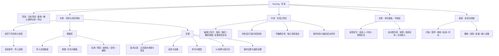
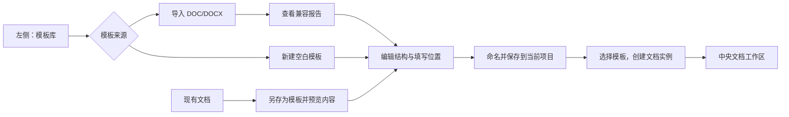
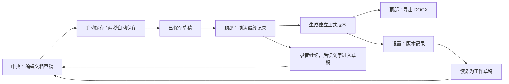
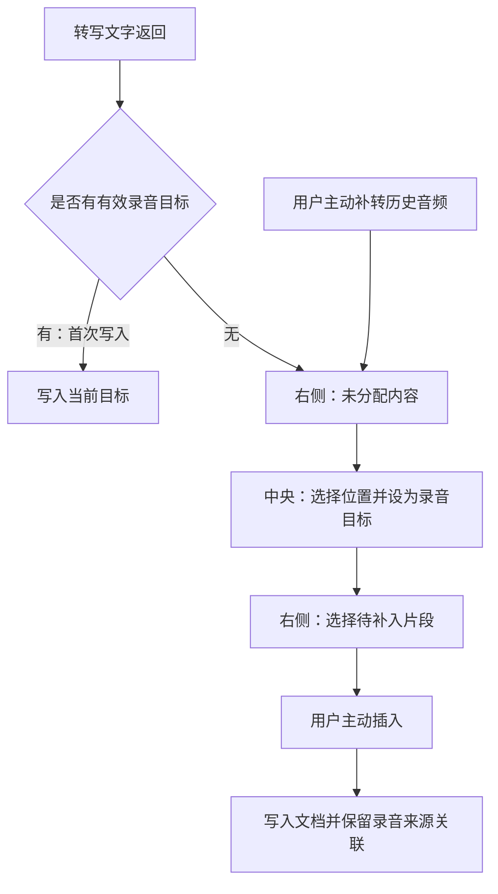

# RecDog · 听录：第一版产品设计

日期：2026-11-02\
状态：已确认需求与布局方案；详细控件建议单独标注。本文不代表页面代码已修改或功能已通过验收。

依据：[需求规格](requirements-v1.md)、[技术设计](technical-design-v1.md)、[术语表](../GLOSSARY.md)，以及用户提供的两张视觉参考和七条原型批注。本文未新增网络调研结论，也不把参考图中的网页内容当作产品需求。

## 1. 产品与设计目标

英文名 **RecDog**，中文名 **听录**。产品是用于访谈、会议及模板化记录的单人桌面工作工具。核心任务是：选择项目与成员，选择模板或新建文档，录音并转写，编辑文档，确认最终记录，再导出 DOCX。AI 整理为可选功能。

视觉以现代简约、细线、清晰分区为主。白色文档、浅灰工作区、深色文字，少量黄色可用于录音目标或关键状态；不做宣传式首页、巨型标题、装饰插画或密集卡片。参考图提供的是视觉方向，不照搬其网站导航与展示区。

布局优先保障中央文档的阅读宽度、编辑操作与长文档滚动。低频管理操作放入模板库和设置；录音状态、保存状态与录音目标应容易辨认。

## 2. 功能位置图

以下主结构已获用户确认；设置内部的分类和录音导入的具体按钮位置为本轮设计建议，可在后续评审调整。



### 桌面布局示意

```text
┌───────────────────────────────────────────────────────────────────┐
│ RecDog 听录     当前项目          搜索      确认最终记录    导出      │
├────────────┬───────────────────────────────────┬──────────────────┤
│ 当前项目   │ 当前成员 / 文档标题                 │ 转写       收起  │
│ 项目成员   ├───────────────────────────────────┤                  │
│  ├ 文档    │ 保存  格式  撤销/重做  设为录音目标 │ 录音转写         │
│  └ 录音    │ 当前录音目标提示                    │ 未分配内容       │
│            ├───────────────────────────────────┤                  │
│            │                                   │ 说话人 / 时间    │
│            │     可编辑文档，区域内独立滚动      │ 转写段落         │
│            │                                   │                  │
│ 模板库     ├───────────────────────────────────┤                  │
│ 设置       │ 字数 / 保存状态 / 最近保存时间      │ 转写状态         │
├────────────┴───────────────────────────────────┴──────────────────┤
│ 开始 / 暂停 / 结束   录音时长     回放与进度      输入设备           │
└───────────────────────────────────────────────────────────────────┘
```

右栏收起后，中央文档使用释放的空间，并保留明确的“展开转写”入口。长文档只在文档区域内上下滚动，工具栏、录音目标提示与底部录音控制不随正文消失；右侧转写独立滚动。

## 3. 模板库

### 已确认范围

- 文档模板导入放在模板库；左栏不再使用“导入录音或文档”混合入口。
- 支持导入模板、从空白文档自建模板，以及将修改后的文档另存为模板。
- 模板支持名称、预览、重命名、复制、删除。第一版不做复杂拖拽设计器。
- 模板默认随当前项目保存，跨项目通过导入或复制复用。
- 模板定义可复用结构，文档实例是一次具体填写；更换模板创建新文档实例并保留旧文档。

### 交互建议

模板库使用简洁列表加预览，列表显示名称与来源（导入/自建），操作收进单项菜单。首次使用提供“导入模板”“新建空白模板”两个明确入口。DOC/DOCX 导入后显示兼容报告，不能把“不支持的排版”当作正常保留。

删除模板前说明影响范围；不应连带删除已有文档实例。把已填文档另存为模板时，应预览将被保存的内容并让用户清理个人填写信息，避免误把真实访谈内容作为可复用样例。该清理交互为建议，尚未确定自动清空字段的规则。

录音导入属于项目成员下的录音操作，建议放在录音列表的“添加录音”菜单中，与模板导入分开。



## 4. 编辑、保存与版本

工具栏增加“保存”按钮。手动保存与默认每 2 秒自动保存同时存在，保存成功才显示“已保存”和最近成功时间；失败显示原因与重试入口。建议支持 Ctrl+S。

| 操作 | 入口 | 结果 |
| --- | --- | --- |
| 保存草稿 | 中央编辑工具栏 | 保存仍可继续修改的当前草稿 |
| 确认最终记录 | 顶部主操作 | 创建新的正式版本；录音可继续，后续内容仍写入草稿 |
| 查看与恢复版本 | 设置 → 版本记录 | 查看当前文档的正式版本，并执行明确的恢复操作 |
| 导出 | 顶部 | 默认导出选定正式版本为 DOCX；没有正式版本时引导确认 |
| 另存为模板 | 模板库相关操作 | 保存可复用文档结构，不替代草稿或正式版本 |

用户已要求将标题旁“版本记录”和左侧“正式版本”收进设置。设置中的版本页应清楚显示当前项目、成员、文档、确认时间与版本列表，避免误查看其他文档。恢复应回到可编辑草稿，历史正式版本保持不变；具体恢复语义沿用技术设计。



## 5. 转写与“未分配内容”

**通俗解释：已经识别出来，但还没有写进文档指定位置的文字。**

例如，用户删除了当前正在接收转写的单元格。录音继续，但软件不能猜测把后续文字写到哪里，因此先保留在“未分配内容”中。历史音频补转的结果也先进入这里，由用户选择位置后补入。

用户只是在询问其含义，因此保留这项既有能力，不把批注理解成删除要求。建议在面板中显示：“这些文字尚未写入文档。请选择录音目标，再插入所需内容。”空状态说明“暂无未分配内容”。

普通点击文档只移动编辑光标，必须明确执行“设为录音目标”才能改变转写写入位置。重新设置目标不会自动补入积压内容；用户选择片段并执行“插入当前录音目标”后才建立关联，成功后更新待处理状态，避免重复插入。点击转写片段只定位音频，不自动播放。



该图只描述新内容首次写入与补转。已写入的临时转写后续修正仍按原绑定处理，不因用户更换目标而移动；人工修改内容不得被后台结果覆盖。

## 6. 设置分类建议

| 分类 | 内容 | 作用范围 |
| --- | --- | --- |
| 版本记录（入口位置已确认） | 正式版本、查看与恢复 | 当前项目中的选定文档 |
| 录音与设备 | 输入设备、麦克风/系统声/混合、可选录音提示 | 设备及录音配置 |
| 转写与模型 | 本机模型下载/指定目录、在线服务、连接测试、说话人分离 | 转写能力；不与 AI 共用开关 |
| AI 处理 | 接口地址、模型、密钥、连接测试、提示词模板 | 可选文本处理 |
| 保存与通用 | 项目保存位置说明、模型目录、自动保存说明、便携设置 | 清楚区分项目数据与应用设置 |

在线转写与 AI 上传必须主动启用，密钥不随项目保存；这些能力沿用既有需求。设置只是入口组织，不改变项目数据或版本的归属。正式版本不能因为入口放进设置而变成所有项目共用的数据。

## 7. 批注处理与验收

| 来源 | 文档结论 | 后续验收 |
| --- | --- | --- |
| 三项“是” | 主布局及右栏可收起、自建与管理模板、模板随项目保存均已确认 | 实施后验证对应入口和迁移行为 |
| 批注 1：导入入口 | 文档模板导入归模板库；录音导入单独归项目成员 | 不再出现混合导入按钮，模板库能找到导入操作 |
| 批注 2、3：版本入口 | 收进设置 → 版本记录，删除主界面重复入口 | 能找到当前文档的正式版本，确认最终记录仍可用 |
| 批注 4：保存 | 工具栏增加保存，区分自动保存、确认与导出 | 手动保存可触发提交，失败不显示成功，重开可见已保存内容 |
| 批注 5：含义咨询 | 为未分配内容补通俗说明与产生场景 | 目标删除后文字可暂存，重设目标不会自动补入 |
| 批注 6：无法滚动 | 登记为原型待修复问题，独立滚动是必须满足的要求 | 鼠标在文档正文、表格及可编辑区域上均可滚至末尾，再返回顶部；录音控制不消失 |
| 批注 7：名称 | 英文 RecDog，中文听录 | 后续界面标题、品牌名称统一更新 |

补充布局验收：在用户批注所用的 1137×827 窗口与常见桌面窗口检查文档滚动、工具栏可达性、右栏收起/展开、转写独立滚动；收起右栏不影响正在录音或录音目标。四小时录音对应长文档仍需按技术设计做性能验证，静态示意图不能替代验收。

## 8. 当前交付边界

本次按用户要求只更新文档，保留现有原型代码原样。浏览器中的页面仍可能显示旧名称、旧入口和滚动问题。本文的设置分类、模板列表形式及个别按钮位置是可评审的产品建议；已确认事项和已有录音、保存、转写规则不因这些建议而改变。未新增不可逆架构决定，因此本轮不新增 ADR。
