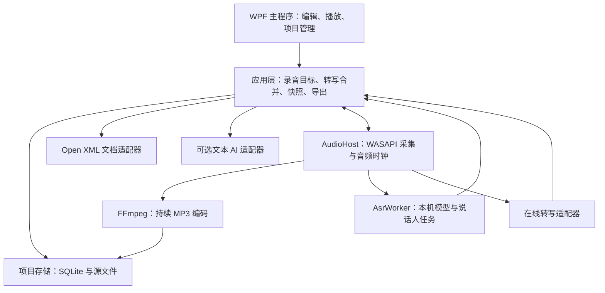

# 录音文档工作台：Windows 桌面技术架构建议

> 当前结论：用户已明确 Windows 工具为当前重点，手机后续仅承担随身录音、转写、查看和简单修改，复杂模板留在电脑处理。推荐采用本文的 C# / WPF Windows 路线，未来手机端单独选型，共用项目数据格式。Flutter 调研保留为后续候选，当前不要求跨端共用界面框架。

日期：2026-11-02。状态：技术选型建议，尚未实施，不替代已接受的需求与 ADR。

依据：`docs/requirements-v1.md`、`GLOSSARY.md`、ADR 0001—0009，以及用户补充的“尽量全部采用免费开源组件，接受更多开发与兼容性处理”。文档边界以用户最新澄清为准：DOC/DOCX 作为导入格式，软件内编辑自己的内容模型，最终导出 DOCX，格式变化不大即可；不实现完整 Word 文件编辑器。

## 1. 建议结论

第一版推荐 **C# + WPF + 受目标 Windows 版本支持的 .NET LTS + SQLite + NAudio/WASAPI + FFmpeg + sherpa-onnx + Open XML SDK**。

产品形态是本机运行的 Windows 桌面程序，提供安装包与解压运行的便携包；无需自建网站、业务服务器或账号系统。在线转写和 AI 由桌面程序在用户主动启用后直连对应服务。

软件结构采用**模块化桌面应用，加独立录音进程和本机推理进程**。领域规则与窗口界面分离，但第一版不引入微服务、消息队列服务器、第三方插件平台或通用工作流引擎。

文档部分推荐**导入转换 → 软件内部文档模型 → 原生富文本编辑 → DOCX 导出**。内部可以使用段落、文字样式和表格等结构，不以 DOCX 文件作为实时工作格式，也不需要嵌入完整办公套件。

Open XML SDK 负责导入、导出时的格式转换，WPF 编辑层负责软件内的填写和编辑；两者职责不同。[S1] 首版重点保留文字、基本样式、表格及页面设置，不要求逐像素还原 Word 分页。真实模板验证用于确定“格式变化不大”的实际接受范围，不把无损往返作为默认目标。

### Windows 版本特别说明

新项目可优先评估 .NET 10 LTS，但不能直接写成“.NET 10 官方支持所有 Windows 10”。当前 Microsoft Windows 安装/支持表对 Windows 10 存在 LTSC/Enterprise 等版本限制，详见配套组件调研。需求只写 Windows 10/11 64 位，仍须具体到版本与版本号。

普通 Windows 10 的实际运行兼容性、Microsoft 的官方支持范围，是两件事。若普通 Windows 10 必须覆盖，应把它纳入明确的实机验收与发布承诺；若还要求运行时受官方支持，则须先解决支持基线。不要为绕过这个问题直接退回临近或已经结束支持的旧版 .NET。

## 2. 为什么适合这个需求

| 需求约束 | 架构上的对应选择 |
| --- | --- |
| Windows 优先，安装版与便携版 | WPF 原生窗口、Windows 音频接口、本机文件访问；自包含部署 |
| 单次连续录音至少四小时 | 专用录音进程持续编码写盘，音频不全部驻留内存 |
| 模型慢也要能录音和编辑 | 本机转写单独进程；识别积压记录为磁盘音频范围 |
| 免费开源优先 | 使用原生富文本能力与开源格式库，不采购 Word 编辑控件 |
| DOC/DOCX 仅用于导入、DOCX 用于导出 | 导入转内部模型，编辑和保存内部内容，导出时生成 DOCX |
| 两秒自动保存 | 草稿变化写 SQLite 事务；不每两秒重打包 DOCX、历史版本和音频 |
| 项目目录可复制迁移 | 每个项目一个 SQLite 与独立源文件目录；模型和密钥放在项目外 |
| 将来可能有 macOS/手机 | 提前稳定项目格式和领域协议；接受将来重做平台界面与采集适配器 |

WPF 是针对当前 Windows 版本的选择，不承诺界面代码直接迁移到 macOS。将来的手机端也不必复刻完整桌面编辑器。

未来手机端以随身采集、查看和轻量修改为主，具体语言与框架后续确定。现在只提前定义项目格式、稳定编号、音频与段落来源关联、版本规则和可支持的内容子集。手机端将来遇到不能编辑的复杂内容时应保留并标示，避免简单修改后重新保存破坏桌面模板；这属于格式兼容约束，不要求当前实现手机客户端或云同步。

## 3. 推荐组件

| 能力 | 推荐 | 实施边界 |
| --- | --- | --- |
| 桌面界面 | WPF + C#，MVVM | 录音控制、项目树、转写列表、文档工作区；UI 不直接承载模型推理 |
| 应用运行时 | 优先评估 .NET 10 LTS | 按实际 Windows 支持基线锁定版本；便携包包含所需运行时 |
| 麦克风与系统声音 | NAudio + WASAPI / Loopback | NAudio 官方列出设备枚举、采集、系统声音采集与重采样等能力；混音同步仍需开发验证。[S2][S3] |
| MP3 编码及音频导入 | 固定版本的 FFmpeg，本机子进程 | 从 PCM 管道持续编码；同时处理 WAV/M4A 等导入。发布前核对实际构建的许可证和外部组件，不将“开源”理解成无分发条件。[S7] |
| 本机实时转写 | sherpa-onnx，先评估中文流式模型 | 官方支持 Windows、C#、流式/非流式识别，也列出中文流式示例；准确率、时间定位、内存与延迟须逐模型实测。[S4] |
| 本机转写备选 | whisper.cpp | 官方支持 Windows、CPU 推理与 VAD；可评估录后精转写，但不据此承诺低配中文实时性。[S5] |
| 说话人分离 | 独立 Diarization 适配器；先评估 sherpa-onnx | 引擎提供该能力不等于能在 8GB 机器上实时稳定分人；与 ASR 分开调度。[S4] |
| DOCX 导入与导出 | DocumentFormat.OpenXml | 将段落、表格、样式与页面设置转换为内部模型，导出时反向生成 DOCX；不承担实时编辑。[S1] |
| 软件内文档编辑 | WPF RichTextBox / FlowDocument + 内部文档模型 | 先复用原生富文本能力，补充表格增删/合并拆分、录音目标与来源关联；不要求控件直接读写 DOCX |
| 项目数据库 | SQLite + Microsoft.Data.Sqlite | 存实体、草稿状态、来源关联、任务、版本索引；不把长音频塞进数据库 |
| 中文搜索 | SQLite 查询起步；再加可重建 FTS5 索引 | 三字及以上可评估 trigram；一二字查询保留子串扫描路径。默认分词器不能直接当成熟中文分词方案。[S6] |
| 在线转写 | 各服务独立 WebSocket 适配器 | 沿用已有实时转写调研，逐服务核对音频格式、临时修正、时间戳与说话人能力 |
| AI 整理 | HttpClient，独立文本服务适配器 | 仅处理用户指定的正式版本，输出独立派生结果 |
| 密钥保护 | 会话内存；主动记住时使用 Windows 凭据保护 | 不进入项目数据库、DOCX 或便携版普通设置 |
| 旧 DOC 转换 | 可选 LibreOffice 转换进程 | 官方有 headless/convert-to；实际 DOC→DOCX 兼容性、组件体积与便携部署须验证，不成为核心功能前置条件。[S8] |

第一版只选择一个本机 ASR 适配器和必要的在线适配器，不把所有候选都实现一遍。本机模型格式、时间戳、说话人能力由适配器声明，不能把不同模型包当成可以随意互换的文件。

## 4. 进程与模块结构



这些模块都在同一台电脑运行。模块边界不要求一模块一进程：推荐先分主程序、AudioHost、AsrWorker，FFmpeg 作为音频模块管理的工具进程。在线网络请求与导出任务也必须避开 UI 线程。

- **主程序**：唯一的项目数据库写入协调者；管理文档状态与段落来源，批量合并后台通知。
- **AudioHost**：采集、混音/重采样、时间轴、持续写入、设备状态。启动录音前完成打开文件和编码器检查。
- **AsrWorker**：加载模型、消费有界输入、输出识别事件；限制并发与推理线程数量，允许降速、暂停和退出释放内存。
- **本机进程通信**：Windows Named Pipes 即可；控制消息用带版本的 JSON，音频使用有边界的二进制块与序号，不把连续 PCM 转成大段 JSON。

独立进程可以隔离模型崩溃，但不会自动消除 CPU、内存或磁盘竞争，仍需限额和长时间测试。AudioHost 不充当隐式后台录音服务；正常关闭严格遵循需求中的“结束并保存后退出/取消关闭”。若主程序意外退出，应检测控制连接断开并停止采集、尽力完成文件收尾，不无限后台录音。这不意味着增加专项崩溃恢复承诺。

建议代码分层：`Desktop`、`Application`、`Domain`、`Infrastructure`、`AudioHost`、`AsrWorker`。Domain 不依赖 WPF、某个模型、某家在线接口或编辑器对象。

## 5. 音频链路的必要设计

### 采集一次，分成归档和识别两路

采集得到 PCM：一路持续编码成项目 MP3，另一路按 ASR 服务需要重采样/转换。识别速度不决定录音速度，不能等一个识别请求结束才继续采集。

归档队列与识别队列均有上限。识别落后时把待处理范围记录为 `recordingId + 起止采样位置`，之后从已保存音频解码补转，不让四小时 PCM 堆积在内存里。普通内存队列不是唯一的待转写记录。

录音写盘也不能无限积压。若磁盘已满、编码器失败或持续写入不足，应明确停止并保存已完成内容、提示录音异常；不能显示仍在正常录音或静默丢帧。硬件故障下不能承诺音频绝不丢失。

### 时间轴必须自己维护

- 以实际采集采样计数建立录音时间轴，暂停时不采集、不增长有效音频时长；另存实际开始时间和暂停事件。
- 转写时间戳、播放位置和来源关联统一到这个时间轴，不能用“文字返回的时间”当音频位置。
- 麦克风与电脑声音可能有独立时钟，混合采集要处理缓冲、静音填充及长期漂移。NAudio 官方说明 Loopback 在完全静音时可能不产生 DataAvailable，不能简单拼接回调。[S3]
- MP3 编码延迟及定位误差要测量，不能只验证“能播放”。
- 多通道输入先保留通道身份再送识别；可采用混合 MP3 加按需分声道 MP3 的资产布局，而不是把全部通道提前混成单声道后再承诺分人。

默认码率暂不锁定。作为容量估算，128 kbit/s 连续四小时约 230MB（十进制，不含元数据和额外声道文件）；这只是磁盘预算示例，不代表已验证的最佳语音参数。

## 6. 文档链路：导入与导出，内部自由编辑

```text
DOC ── 可选 LibreOffice 转换 ──┐
                              ↓
DOCX ── Open XML 导入 ── 软件内部文档模型
                              ↕
                     WPF 富文本编辑与录音填充
                              ↓
                     Open XML 导出 DOCX
```

1. 导入时读取文字、段落样式、表格、内容控件及必要页面设置，转换为内部文档模型。原文件保留作为参考，不要求编辑过程一直与原始 XML 节点绑定。
2. 内部模型至少包含段落、带样式文字、基本列表、表格行列/合并关系、页面设置、录音目标和稳定块编号。内容控件可转换为软件自己的可填写区域。
3. 以 WPF RichTextBox/FlowDocument 验证基本编辑，补充表格操作、目标高亮和录音来源功能；撤销/重做也要覆盖这些自定义操作。内部持久化采用带格式版本的结构化数据，避免只保存控件对象。
4. 导出时从内部内容生成 DOCX，并映射字体字号、粗斜体、下划线、对齐、列表、表格、表格跨页设置、纸张、页边距和页码等。页眉页脚等可单独保存并在生成时带回，不要求整包无损保留。
5. 不支持的复杂对象按兼容报告告知。用真实常用模板比较导出结果，保证正文和表格结构、主要格式符合实际使用要求；少量分页差异不作为默认失败条件。

RichTextBox 不直接支持 DOCX 并不阻碍这条路线，因为格式转换由独立导入/导出模块完成。基本格式转换和表格功能仍需开发，但已经不需要实现一个通用 Word 编辑器。

LibreOffice 在当前路线中仅作为旧 DOC 的可选转换工具，不嵌入其完整界面。[S8] ONLYOFFICE 与商业办公编辑控件不列入首版必需组件；此前对这些引擎的调研仅作为背景资料。[S9]

长文档下先测 FlowDocument/RichTextBox 的排版耗时和内存；若达不到四小时记录的编辑体验，再考虑按块加载等优化，不预先把自研排版引擎列为必要工作。

## 7. 转写和编辑之间最重要的规则

建议业务模型至少包含 Project、Member、Recording、TranscriptSegment、DocumentInstance、DocumentBlock、RecordingTarget、SourceLink、DocumentVersion、AiArtifact、ProcessingJob。

- 临时转写、机器定稿、用户修订与正式版本分别保存，不共用一个会不断覆盖的字符串字段。
- 转写事件包含提供方会话、稳定片段编号、修订序号、音频时间范围及结果类型；无法稳定标识的结果进入待处理内容。
- 第一次写入时将片段绑定到**当时的录音目标**。之后临时修正沿原绑定更新，不能因目标切换迁移。
- 人工编辑将块标记为用户修订，并更新修订号；后台合并检查编号和版本，不能覆盖人工修改。
- 位置绑定使用文档/块/目标的稳定编号，不能依赖当前光标、显示行号或全局字符偏移。
- 内容控件、单元格、段落编辑和合并拆分都要维护编号；目标删除后转写进入未分配内容。
- 断网待转写范围持久化；网络恢复先让用户选择补转历史或只处理后续。补转结果进入未分配内容，不根据讲话时间猜测写入位置。
- 段落来源可以包含一个或多个录音时间范围；纯手工段落允许无来源。模型时间定位不足时明确能力限制，不伪造精确时间。

录音进行中确认正式版本时，先固定一个已提交的文档修订号，后台从该快照生成版本文件；后续录音与编辑写入新的草稿修订，不能等待慢速导出阻塞录音，也不能让导出读到一半新一半旧的数据。

## 8. 项目目录与自动保存

可从以下布局做原型；不把显示名称当成文件关联依据。

```text
项目目录/
  project.json                  # 格式版本、项目ID、最小描述
  project.db                    # 草稿、成员、转写、来源、任务与版本索引
  members/
    <member-id>/
      recordings/
        <recording-id>/
          main.mp3
          channels/             # 按需保存独立通道MP3
      documents/
        <document-id>/
          original.docx         # 不变的模板/导入源
          versions/
            <version-id>/
              document.docx
              annotations.json  # 此版本的块编号与段落来源
  ai-results/
    <artifact-id>/
  cache/                        # 可重建的索引、波形等
```

项目的权威草稿是**数据库中的内部文档内容与关联元数据**。原始 DOC/DOCX 仅作导入来源留存；重新打开项目不必再次解析原文件。正式版本保留不可变的内部内容快照，并可附带生成的 DOCX 与关联元数据。不要让 `draft.docx`、JSON 和数据库各自独立接受编辑，造成三份内容互相打架。

保存策略：

- 数据库采用单写入协调者，短事务保存变化。默认每两秒提交文档与设置变化；音频独立持续写盘，不能把两秒当成所有 I/O 的共同定时器。
- 设置和必要 JSON 使用同目录临时文件写入、完成校验后替换；数据库用事务保证读者看到完整提交。
- 确认版本时先将完整版本文件写入新目录，校验成功后才提交数据库中的版本指针。文件系统与 SQLite 没有共同事务，采用“完整文件先落地、索引后发布”的顺序；遗留未引用文件可后续清理，不能让正式版本索引指向半成品。
- 若采用 SQLite WAL，不得只复制 `project.db` 而遗漏仍有效的 WAL。推荐停止录音、完成保存并关闭项目后复制整个项目目录；要支持运行中一致备份时，再另做数据库快照与文件集合一致性机制。
- 模型放在项目外的共享模型目录；API 密钥不随项目迁移。格式版本迁移必须保留原数据并能报告失败。

这套事务与文件写入纪律用于防止半写入和破坏既有保存数据，不新增专项崩溃恢复窗口、恢复向导或找回未保存内容的承诺。

## 9. 其他桌面方案的取舍

| 方案 | 适用时机 | 对本项目的判断 |
| --- | --- | --- |
| WPF + C# | Windows 优先、设备接入、本地工具 | 首选；复用原生富文本编辑，单独实现 DOCX 格式转换和业务操作 |
| Avalonia + C# | 首版就要求 Windows/macOS/Linux | 可作跨平台替代，但 Windows 音频适配仍需单独实现，也不会自动得到 DOCX 编辑引擎 |
| Qt/C++ 或 PySide6 | 团队熟悉 Qt，或要与原生音频/推理库深度集成 | 能实现，但同样要解决 DOCX；为个人 Windows 首版切换整套技术栈的收益有限 |
| Electron / Tauri | 团队明显擅长前端，愿意承担 WebView 与本机桥接 | 它们能交付真正的桌面安装程序；只是当前需求没有要求这一套，且普通网页富文本编辑器不能解决模板保真 |
| Python 作为整机主程序 | 快速验证模型和算法 | 可用于技术实验；正式分发若引入完整 Python/深度学习运行环境，会增加便携包依赖管理，首选把必要推理封装在独立 worker |

若开发者已有很强的某一技术栈经验，应将学习与维护成本算进取舍。这里是在没有既有实现约束下给出的推荐，不是对其他桌面框架能力的否定。

## 10. 实施前先做三个可验收原型

1. **文档导入、内部编辑与导出原型。** 收集常用真实模板，验证 DOC/DOCX 导入→软件内填写→加删行列/合并拆分→DOCX 导出。检查文字、主要样式、表格与页面设置是否接近原文件，并记录可接受的变化；不把任意 DOCX 无损往返或 Word 分页逐像素一致作为目标。软件运行不依赖安装 Word/WPS。
2. **四小时音频原型。** 测麦克风、系统声、混合采集、静音、暂停继续、设备异常、编码器故障、持续落盘及播放定位；同时开模型推理和编辑压力，观察音频缺口、时钟漂移、内存和保存延迟。
3. **中文转写与目标绑定原型。** 用真实多人中文录音验证流式模型与一个在线候选；测试 A/B 目标切换、迟到修正、用户改字、目标删除、断网补转和确认正式快照。分别记录准确率、延迟、时间定位、分人效果与资源占用，避免用“接口能调通”代替可用性验收。

随后按“项目与保存→录音→模板和编辑→转写与定位→版本→可选 AI→安装/便携验收”推进。原型不构成删减第一版需求的理由，而是用于发现必须解决的选型风险。

## 11. 本次实际核对的一方来源

以下资料用于确认组件边界，不代表已运行软件、完成硬件兼容测试或验证任意模板保真。网页及主分支会变化，实施时应锁定依赖版本。

- [S1：Open XML SDK 官方仓库 README](https://github.com/dotnet/Open-XML-SDK)：实际获取正文；确认低层格式 API 定位，也记录大 ZIP 包的内存风险。
- [S2：NAudio 官方仓库 README](https://github.com/naudio/NAudio)：实际获取正文；确认 WASAPI、系统声音采集、混音、重采样、设备枚举及 MIT 授权说明。
- [S3：NAudio 官方 Loopback 指南](https://github.com/naudio/NAudio/blob/master/Docs/WasapiLoopbackCapture.md)：实际获取正文；确认按输出设备采集与静音不触发回调的提示。本建议不采用文中关于“无法采集单进程”的泛化旧结论，需求也未要求单进程录音。
- [S4：sherpa-onnx 官方仓库 README](https://github.com/k2-fsa/sherpa-onnx)：实际获取正文；确认 Windows/C#、流式与非流式识别、中文示例及说话人能力。具体模型包的许可证与资源需求须独立核对。
- [S5：whisper.cpp 官方仓库 README](https://github.com/ggml-org/whisper.cpp)：实际获取正文；确认 Windows、CPU 推理、VAD 与流式示例，不据此推断中文准确率或低配实时性。
- [S6：SQLite FTS5 官方文档](https://sqlite.org/fts5.html)：实际获取相关正文；确认默认 unicode61、trigram 子串检索，以及少于三个 Unicode 字符的 MATCH 限制。
- [S7：FFmpeg 官方许可证说明](https://ffmpeg.org/legal.html)：实际获取正文；确认 LGPL 基础、可选 GPL 组件影响以及外部库分发条件。没有把任意预编译包统一判定为 LGPL。
- [S8：LibreOffice 官方启动参数](https://help.libreoffice.org/latest/en-US/text/shared/guide/start_parameters.html)：实际获取正文；确认 headless、convert-to、UNO 与独立用户配置目录，不代表已验证具体 DOC 模板转换保真。
- [S9：ONLYOFFICE Desktop Editors 官方仓库 README](https://github.com/ONLYOFFICE/DesktopEditors)：实际获取正文；确认离线 DOCX 编辑、插件、多组件结构与 AGPLv3 定位，不把产品宣传中的“兼容”当成所有模板无损保证。

运行时、WPF 原生编辑能力以及商业组件对照资料见同目录 `desktop-components.md`。在线服务选择沿用 `realtime-transcription-services.md`，接入时重新核对现行接口。
