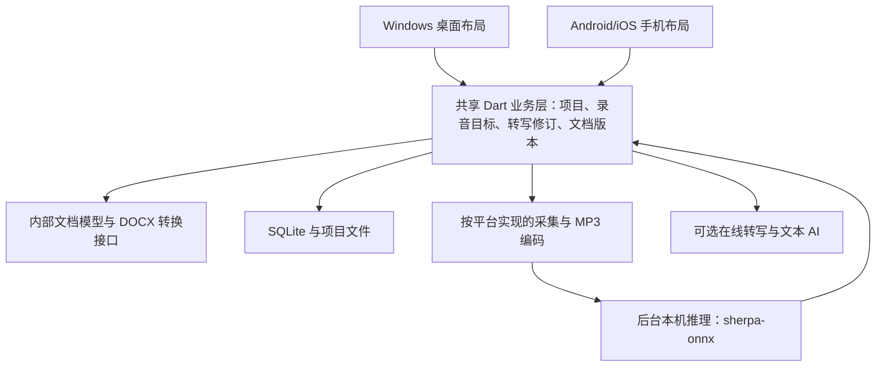

# Flutter 跨端架构建议：Windows 首版，面向 Android/iOS

> 当前定位：跨端方案对照与未来手机端候选。用户已确认当前以 Windows 工具为主，手机后续负责录音、转写、查看和简单修改，复杂模板留在电脑。最新主建议见 `desktop-architecture-recommendation.md`；本文不再作为当前 Windows 首选。

日期：2026-11-02。状态：建议与验证计划，尚未实现或测试。用户最新约束：免费开源优先；DOC/DOCX 是导入格式，软件内编辑自己的内容，导出 DOCX 后主要格式接近即可；未来明确考虑手机端，并关心电脑与手机的速度和流畅度。

## 1. Flutter 的适用条件

**如果未来需要同期开发功能相近的电脑与手机客户端，可将 Flutter + Dart 作为共享业务、数据模型和部分界面的候选，并先验证关键原型。当前 Windows 首版采用 WPF 路线，手机技术栈暂不锁定。**

Flutter 复用业务、内部文档模型和部分界面的收益，在两端功能接近时更明显。目前电脑承担复杂模板、手机以轻量操作为主，分别设计客户端是合理选择；将来的手机应用也不必复刻整套桌面功能。

Flutter 的 Windows/Android/iOS 发布应用可以编译为机器码，通过自身引擎绘制界面，并可用平台通道或 FFI 接入原生代码。[F1] 它能交付桌面安装程序和手机 App，界面流畅并不存在由框架决定的明显先天障碍；但没有针对这个产品、模型和设备实测前，不能承诺“所有设备都流畅”或“本机中文识别一定实时”。

Flutter 官方当前支持平台表列出 Windows 10/11、Android 与 iOS，具体最低版本和插件要求应在锁定版本时再次核对。[F4]

## 2. 三种性能不要混为一谈

| 用户体验 | 主要受什么影响 | 本项目的做法 |
| --- | --- | --- |
| 打字、滑动、切换页面流畅 | 主界面任务量、布局、重绘范围、文档长度 | 小范围更新、按需构建、避免同步重活 |
| 中文转写能否跟上讲话 | 模型、CPU/GPU、线程数量、手机温度与功耗 | 独立推理、有界缓冲、逐设备模型分级 |
| 导入导出、保存、搜索速度 | 文档复杂度、磁盘、数据库事务、格式转换 | 后台处理、增量保存、分页读取、可重建索引 |

换 Flutter 不会让同一个大模型在低端手机上突然变快；模型落后也不应该使文字输入或录音卡住。语音结果稍有延迟、界面仍然流畅，是可接受且应该主动支持的状态。

## 3. 推荐结构

推荐模块职责：

- **Flutter 展示层**：电脑使用多栏布局、键盘快捷键和鼠标操作；手机采用触摸布局、分屏页面与软键盘适配。复用组件与业务，不把桌面窗口简单等比缩小。
- **共享 Dart 业务层**：稳定段落/单元格编号、录音目标、首次结果归属、人工修订保护、未分配内容、正式版本和 AI 派生结果。
- **共享数据层**：SQLite、带格式版本的内部文档数据、相对路径与稳定 ID。不要把 Windows 盘符和绝对路径写成跨端项目格式的一部分。
- **平台音频适配器**：Windows 的设备选择、WASAPI 系统声音与混录；Android/iOS 的麦克风、权限、音频会话和应用生命周期。
- **后台计算层**：本机转写、说话人分离、DOCX 解析/生成与大型索引处理；采用长期运行的 isolate 或原生工作线程，避免不断创建短命工作单元。

Windows 可把重型本机推理放在独立进程以隔离故障；手机应使用符合平台生命周期的原生工作线程/服务和 Dart isolate，不能照搬随意启动桌面 EXE 的结构。isolate 不是独立进程，也不会自动隔离原生库崩溃。

## 4. 组件选择与边界

| 模块 | 建议 | 仍需补充的工程 |
| --- | --- | --- |
| UI 与共享逻辑 | Flutter + Dart | 平台布局、中文输入、快捷键、触摸交互分别验收 |
| 状态管理 | 选一种成熟方式，例如 Riverpod | 优先限制重建范围；状态管理库名称不能代替性能设计 |
| 项目存储 | SQLite + 文件资产 | 各平台数据库/文件适配器；单写入协调、两秒草稿提交、关闭项目后可复制备份 |
| 麦克风 | `record` 作为候选 | 官方确认 Windows/Android/iOS PCM 流，但不代表系统声采集或 MP3 已解决。[C1] |
| Windows 系统声音 | WASAPI 原生插件 | 混音、静音填充、长期时钟漂移、多声道与设备兼容性 |
| 本机中文转写 | sherpa-onnx Flutter/原生接口 | 官方有三端流式示例；实际模型的准确率、时间戳与资源消耗须测试。[C2] |
| 软件内部富文本 | 评估 flutter_quill；需要表格能力扩展原型 | 尚未核验有免费现成组件覆盖全部表格增删/合并拆分；不能直接宣称开箱即用。[C3] |
| DOCX | 单独的导入/导出转换器 | 在 Dart 层以 XML/ZIP 工具处理需求中的 OOXML 子集，或封装跨平台格式库；不把 .NET Open XML SDK 直接当成 Dart 库 |
| 旧 DOC | Windows 可选 LibreOffice 转换 | 手机如果也必须原生离线导入 DOC，需要另选可嵌入转换方案；Windows 工具不自动适用于手机 |
| MP3 | 持续编码接口，逐平台固定原生编解码构建 | 采集插件没有确认提供 MP3。可评估 LAME 等原生编码器；构建、许可证、暂停继续、写入和体积必须核对 |

不要为了“高性能”从第一天就同时引入 C#、Python、Rust 和 C++。先以 Dart 和确实必需的平台代码为主；可用的维护中插件先复用，只有实测或能力缺口才增加原生模块。

### 文档编辑是 Flutter 选型最重要的原型之一

用户已经明确不需要 Word 编辑器。文档链路应保持简单：

`DOC/DOCX 导入 → 内部段落/样式/表格模型 → 软件内编辑与录音填充 → DOCX 导出`。

不必完整保留原始 DOCX 的全部节点或模拟 Word 分页。仍要支持需求中的表格合并拆分、模板填写与主要格式，不能因换 Flutter 悄悄删掉这些功能。

flutter_quill 官方支持 Delta JSON 和自定义嵌入块，但已核对资料没有证明完整表格操作与免费内置 DOCX 转换；Super Editor 官方则把 Windows 列为 Unverified，因此不能无条件用它作为 Windows 首版基础。[C3] 这些是需要验证和补充实现的地方，不是 Flutter 无法实现。

先用真实模板验证中文输入法组词、连续录音插入、表格操作、跨段选择与撤销，再选择编辑器。内部模型独立于特定编辑器，保留今后替换组件的空间。

### 音频不能只依赖一个插件名称

`record` 的官方能力是麦克风采集，不能推出它能采集 Windows 系统声音；其已核对编码表未列 MP3。[C1]

旧 FFmpegKit 已退休，官方 2026 年更新又列出原作者维护的 source-only 继任项目。不能照旧教程直接认定有长期维护、开箱可用、同时覆盖 Windows 和手机的二进制包。[C4] 可以继续评估 FFmpeg 或其他编码库，但按实际构建与平台能力选取，不把一个旧封装当成全平台方案。

## 5. 保持流畅的实施规则

1. **主界面不做推理与大文件转换。** Dart `async/await` 不等于 CPU 重活已经离开主 isolate；同步模型调用、XML/ZIP 解析和大 JSON 处理要明确安排执行位置。FFI 是调用通道，不是自动后台线程。[F1][F3]
2. **识别结果小范围更新。** 临时文字可按约 100—200ms 合并通知，作为原型参数；机器定稿及时应用，不每来一个字就重新布局全文。用户输入不能等待识别刷新定时器。
3. **长记录按需展示。** 转写列表按可见范围构建，波形只加载需要的分辨率；长文档编辑控件本身也要测试，不能以列表做了懒加载就假设整个富文本已经虚拟化。[F2]
4. **音频持续保存、队列有上限。** 采集归档与 ASR 分路，落后的待处理音频记录成磁盘范围；不把四小时 PCM 留在内存。转写慢时不阻塞录音。
5. **限制本机推理资源。** 控制模型大小、线程数量和说话人分离并发，给 UI 与系统留余量。手机需要持续运行后再测热降频、耗电与资源回收，不能只用冷机前一分钟评估。
6. **自动保存写内部变化。** 默认两秒提交草稿，导出时才生成 DOCX，不每两秒重建整个 Word 文件或复制所有历史音频。
7. **处理应用生命周期。** 锁屏、来电、蓝牙切换、被系统回收、后台权限都要明确状态；若未来要求手机锁屏持续录音，须按 Android/iOS 分别实现和验收。电脑系统声音采集不等于手机允许录制其他应用或通话声音。
8. **用正式性能模式与真机验收。** Flutter 官方建议用 profile 模式分析，关注构建与渲染预算，不以 debug 模式或模拟器表现判定上线速度。[F2]

Flutter isolate 拥有独立内存并通过消息通信；它不是共享内存线程。持续音频传输要控制消息大小和复制次数，而且插件在后台 isolate 的消息支持存在边界，具体插件是否适用需验证，不能把任意录音插件直接移过去就算完成。[F3]

## 6. 推荐性能验收目标

以下是待测试、可调整的工程目标，**不是已经达到的结果**。

| 场景 | 建议目标或观察项 |
| --- | --- |
| 普通滑动、页面切换 | 以 60fps 为基础目标；高刷作为后续优化，不承诺任意手机都稳定 120fps |
| 连续文字输入 | 无明显持续卡顿；可先以输入到显示的 P95 小于 100ms 作为讨论基线 |
| 录音 + 转写 + 编辑 + 自动保存 | 同时开启验收，录音不能等待 ASR、格式导出或搜索 |
| 四小时录音 | Windows 至少完成原需求时长；观察缺口、漂移、内存是否持续增长、磁盘写入与保存延迟 |
| 手机长时运行 | 在目标中端真机持续录音与编辑，测温度、耗电、掉帧、系统中断；若手机也要求四小时，按同等时长实测 |
| 本机实时转写 | 处理速度需长期快于采集；RTF 小于 1 是基本条件，建议留余量，不用一次短样本作保证 |
| 算力不足 | 允许识别落后并显示状态，可主动暂停识别/录后处理/选择在线；不自动上传、不牺牲录音与输入 |

设备矩阵至少包含：原需求的 8GB Windows 机器、推荐配置电脑、目标价位 Android 真机；若计划 iPhone，则加入目标 iPhone。iOS 的构建与签名工具链需要 macOS/Xcode，应列入后续开发条件，不意味着桌面端必须改用 Mac。

## 7. 与 WPF 的最终取舍

| 决策因素 | WPF | Flutter |
| --- | --- | --- |
| Windows 专用系统能力 | 直接接入方便 | 可实现，需要插件/原生桥接 |
| 未来 Android/iOS | 另做手机界面和大量应用逻辑适配 | 可共享 Dart 业务、数据和部分界面 |
| 电脑与手机流畅度 | Windows 可以做好，手机另选技术 | 三端都可以做好，取决于工作负载隔离与组件质量 |
| 表格与 DOCX | 需要格式转换和业务表格开发 | 同样需要，而且编辑组件的 Windows 适配要重点验证 |
| 当前建议 | **当前 Windows 首选** | 保留作后续手机及跨端候选 |

若后续重新评估 Flutter 桌面路线，应先做 Windows 中文输入/模板表格编辑与多端音频小样验证，再评估复用收益和维护成本。当前不因这一候选提前实施三端界面。

## 8. 本次来源与验证边界

官方网页正文和项目 README 已实际读取；未安装 Flutter、运行模型、构建 App 或做任何性能测量。

- [F1：Flutter Architectural overview](https://docs.flutter.dev/resources/architectural-overview)：发布机器码、引擎、平台通道与 FFI。
- [F2：Flutter Performance best practices](https://docs.flutter.dev/perf/best-practices)：减少构建/布局成本、懒构建、60Hz 帧预算与 profile 模式。
- [F3：Flutter Concurrency and isolates](https://docs.flutter.dev/perf/isolates)：独立内存、消息通信、长期后台任务与插件边界。
- [F4：Flutter Supported deployment platforms](https://docs.flutter.dev/reference/supported-platforms)：Windows、Android、iOS 的当前平台支持表；框架支持不替代插件支持。
- C1—C4 的官方来源、实际核验结论与限制见 [flutter-platform-components.md](flutter-platform-components.md)：record、sherpa-onnx、Flutter Quill/Super Editor 与 FFmpegKit。

当前 Windows 主建议以 `desktop-architecture-recommendation.md` 为准；本文与组件核验作为后续选型参考。手机不纳入第一版交付，当前只稳定跨端数据约定。
