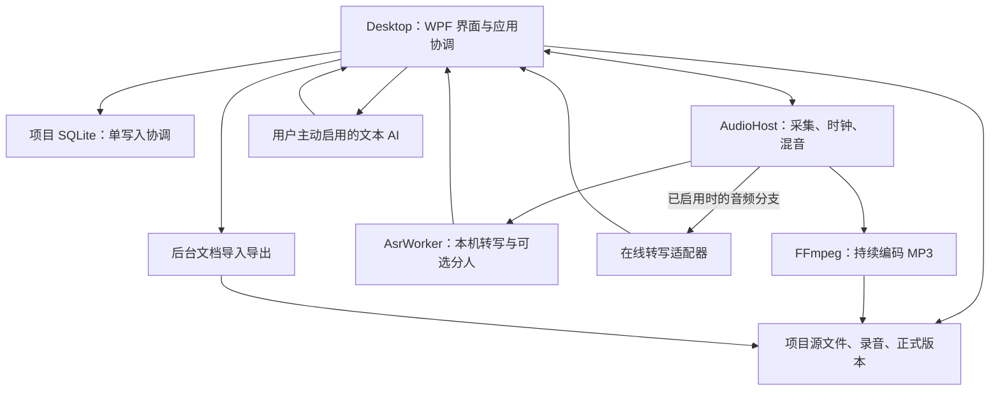
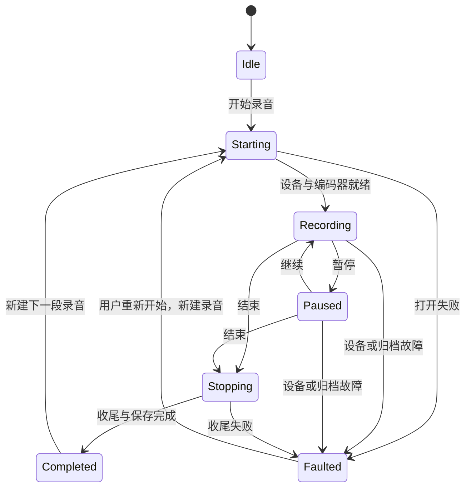
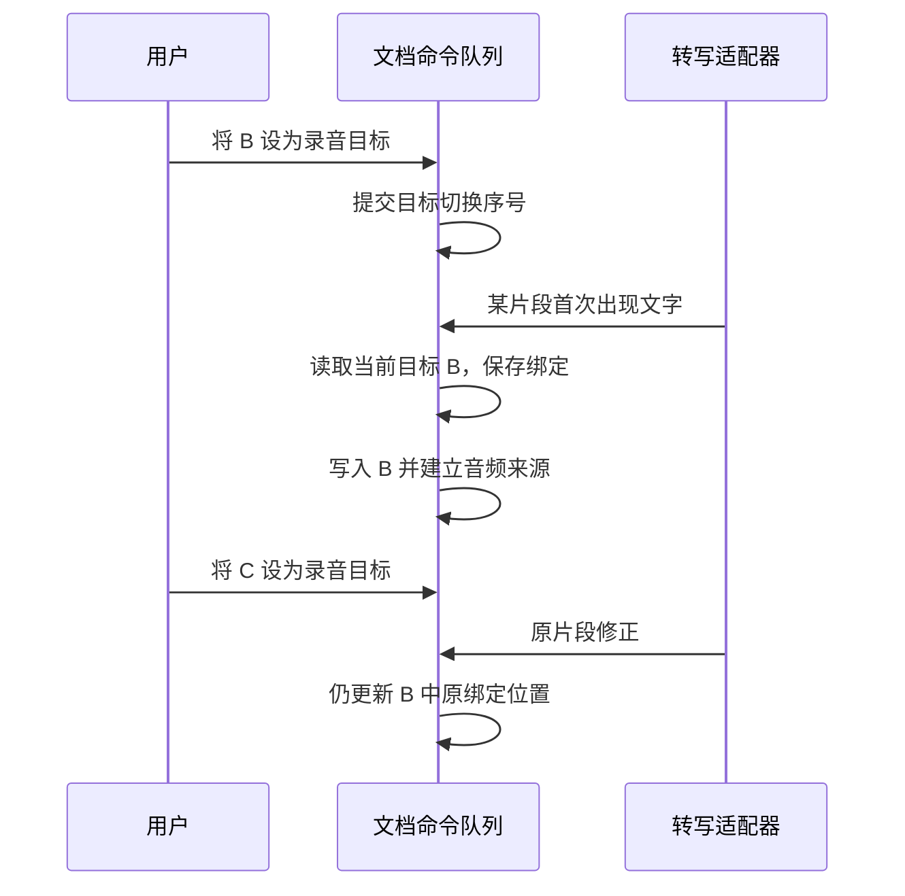

# RecDog · 听录：第一版技术方案

版本：0.1（评审稿）\
日期：2026-11-02\
实施状态：尚未编码、构建或完成性能测试。本文给出建议实现方式，不把候选组件能力等同于已验证的产品能力。

## 方案概览

| 评审问题 | 本方案建议 |
| --- | --- |
| 做成什么 | 本机运行的 Windows 工具，提供安装版和便携包 |
| 用什么开发 | C# / WPF，SQLite 保存工作数据，音频与文件独立保存 |
| 怎样保持流畅 | 采集持续写盘，模型独立运行，编辑和保存避免阻塞 |
| 文档怎样处理 | DOC/DOCX 导入后成为内部内容，最终生成 DOCX，不做完整 Word 编辑器 |
| 如何保护人工记录 | 人工修订不被识别覆盖，确认版本保持不变，AI 只生成独立派生结果 |
| 先做什么 | 验证真实模板编辑、四小时录音、中文模型和目标切换，再分阶段实现 |
| 手机怎样预留 | 统一项目格式与内容关联，手机以后另行开发轻量功能 |

## 阅读说明

本方案依据以下资料编写，需求与已接受 ADR 优先；技术验证不通过时调整实现，不默认删减第一版功能。

- [第一版需求](requirements-v1.md)
- [产品设计：功能位置与操作流程](product-design-v1.md)；2026-11-02 已确认的界面要求见需求文档“界面、模板管理与保存”。这些要求尚未在现有原型中落地。
- [Windows 架构建议](research/desktop-architecture-recommendation.md)
- [术语表](../GLOSSARY.md)与 [ADR 目录](adr/)
- [桌面组件核验](research/desktop-components.md)、[实时转写服务调研](research/realtime-transcription-services.md)

第 1—3 节说明范围和总体架构；第 4—12 节说明核心实现；第 13—17 节说明部署、性能、验收与开发顺序；第 18—20 节说明未来手机端、待验证项与需求覆盖关系。

## 1. 目标与范围

### 1.1 产品目标

交付本机优先的 Windows 单人记录工具，完成“创建项目 → 导入模板或新建文档 → 录音与转写 → 编辑并确认最终记录 → 导出 DOCX”的完整流程。AI 整理为可选后续处理，用户不用 AI 也能完成正式记录。

首版交付 Windows 64 位安装版与便携目录包。手机端后续承担随身录音、转写、查看和简单修改，当前只保留数据兼容边界；复杂模板编辑与正式文档整理留在电脑端。

### 1.2 已确认的设计约束

| 约束 | 实现原则 |
| --- | --- |
| 免费开源优先 | 不以商业 Word 控件为必要依赖；固定实际组件及模型版本，核对分发条件 |
| DOC/DOCX 用于导入，DOCX 用于导出 | 软件内部使用自己的文档模型，不直接编辑 Word 文件，不嵌入完整办公套件 |
| 主要格式变化不大即可 | 保留正文、表格与主要页面设置，不追求任意 DOCX 无损往返或 Word 分页逐像素一致 |
| 单次录音至少四小时 | 持续编码落盘；采集、识别、编辑和保存不能相互等待 |
| 两秒自动保存 | 对文档、转写、来源及设置的变化进行周期提交，音频独立持续写入 |
| 一个项目是普通目录 | 数据库与源文件位于目录内，关闭项目后可复制整个目录备份 |
| 同一时间一场录音 | 全局录音协调器控制，切换项目和退出均先按需求确认结束 |
| 本机与在线均可选 | 默认不上传；在线转写与文本 AI 独立配置、独立启用 |

### 1.3 不纳入首版

手机客户端、云同步、多人协作、账号系统、第三方插件 SDK、专项崩溃恢复向导、声纹身份识别、多个独立 USB 麦克风同步采集、补录与标记、Markdown 导入导出、复杂嵌套表格及浮动文本框的创建编辑。

不开发专项恢复功能不等于允许破坏已保存数据：数据库事务、完整文件发布、正常退出收尾仍然必须实现。重开只加载最近已保存内容，不自动恢复录音。

## 2. 技术选型与支持基线

| 部分 | 建议选型 | 用途与边界 |
| --- | --- | --- |
| 开发语言与运行时 | C#，优先评估 .NET 10 LTS | 最终版本受目标 Windows 支持基线约束，发布时锁定补丁版本 |
| Windows 界面 | WPF + MVVM，CommunityToolkit.Mvvm | 原生窗口、快捷键、绑定和交互；界面对象不进入项目格式 |
| 应用组织 | 模块化应用 + 必要工作进程 | 不部署服务器，不引入微服务平台或外部消息队列 |
| 音频采集与播放 | NAudio + WASAPI | 麦克风、系统声音、重采样、设备枚举与播放；混音时钟需要自行协调 |
| 编解码 | 固定版本 FFmpeg 工具进程 | PCM 持续编码 MP3，导入 WAV/M4A 等；不参与文档格式转换 |
| 本机转写 | sherpa-onnx + 经测试的中文流式模型 | 单独工作进程；运行库、模型和配置共同组成受支持组合 |
| 备选转写引擎 | whisper.cpp | 只在原型比较有必要时评估录后转写，不默认同时集成 |
| 在线转写 | 原生 WebSocket/HTTP 提供方适配器 | 首先验证一个中文实时候选；Qwen-ASR-Realtime 可作为首轮候选，不提前保证准确率或说话人能力 |
| 说话人分离 | 独立 Diarization 适配器 | 可评估 sherpa-onnx 对应模型；可关闭，不与 ASR 成败绑定 |
| 文档界面 | WPF RichTextBox/FlowDocument + 编辑适配层 | 复用基本富文本，补充表格命令、录音目标和来源关联；须验证长文档性能 |
| DOCX 格式转换 | DocumentFormat.OpenXml | 导入内部模型、从内部模型导出；不提供编辑界面或 Word 排版引擎 |
| 旧 DOC 转换 | 可选 LibreOffice 子进程 | 转成临时 DOCX 后走统一导入链路；缺失时仅旧 DOC 兼容能力不可用 |
| 本地数据库 | SQLite + Microsoft.Data.Sqlite | 参数化 SQL、显式迁移、单写入协调；不存长音频 BLOB |
| 网络与文本 AI | HttpClient + JSON，按服务处理流式响应 | 只处理指定正式版本；与实时音频接口分开 |
| 秘密保存 | 会话内存；用户主动记住时 DPAPI CurrentUser | 密钥不写项目；保存的密文只承诺当前 Windows 用户环境可用 |
| 安装与便携 | win-x64 自包含目录产物；安装器候选 Inno Setup | 两种发行形态共用核心文件，模型和可选 DOC 转换工具分开管理 |

**Windows 支持门槛：** 需求中的 Windows 10/11 需具体到版本、版本号与测试机器。已有组件核验指出 .NET 10 当前官方支持表对 Windows 10 存在版本限制，不能直接承诺覆盖所有普通 Windows 10。原型阶段应同时记录实际运行兼容性与运行时官方支持情况；发布前明确支持清单。自包含发布不会绕过操作系统要求，也不为兼容随意退回失去支持的运行时。

本文不固定尚未验证的模型名称、NuGet 版本、FFmpeg 构建参数或录音码率。原型通过后形成依赖锁定清单，至少记录版本、下载源、校验值、许可证、架构和对应验收结果。

## 3. 总体架构

### 3.1 进程关系



主程序、AudioHost、AsrWorker 是首选进程边界；FFmpeg 由音频模块启动和监管。文档和网络任务先采用主程序内后台任务，若测出内存或原生故障隔离需求，再提取工作进程。

AudioHost 只向已经获准的在线链路提供音频。网络适配器可以由主程序内后台任务承载，但不能在 WPF UI 线程上编码、发送或解析连续音频。

### 3.2 代码工程划分

```text
src/
  RecordNote.Desktop/             WPF、ViewModel、交互与编辑器适配
  RecordNote.Application/         用例、命令协调、状态机、任务调度
  RecordNote.Domain/              项目、转写、文档、目标与版本规则
  RecordNote.Contracts/           工作进程通信 DTO 和协议版本
  RecordNote.Infrastructure/      SQLite、文件、配置、提供方和 DOCX 实现
  RecordNote.AudioHost/           采集与编码监管
  RecordNote.AsrWorker/           本机推理与分人任务
tests/
  RecordNote.Domain.Tests/
  RecordNote.Integration.Tests/
  RecordNote.Acceptance/          场景脚本、测试资产说明与性能记录
```

依赖方向：Desktop → Application → Domain；Infrastructure 实现应用层定义的接口；Domain 不依赖 WPF、SQLite、音频库、模型或某个服务商的数据类型。Contracts 不携带 UI 对象、密钥或任意编辑器序列化对象。

### 3.3 主要接口职责

| 边界 | 建议接口 | 负责 | 不负责 |
| --- | --- | --- | --- |
| 采集 | IAudioCaptureService | 设备、状态、PCM、采样时钟 | 分配文字到文档 |
| 归档 | IAudioArchiveWriter | MP3 生命周期、写入状态、错误 | 转写服务选择 |
| 转写 | ITranscriptionProvider | 能力、连接、输入、标准结果事件 | 直接操作 WPF 文档 |
| 分人 | IDiarizationProvider | 时间范围与说话人聚类 | 真实身份判断 |
| 文档格式 | IDocumentImporter / IDocumentExporter | 格式映射、兼容报告 | 管理录音会话 |
| 文档业务 | IDocumentCommandService | 编辑命令、目标与来源更新 | Word 分页复刻 |
| 存储 | IProjectStore | 查询、事务、迁移、一致快照 | 业务目标选择 |
| AI | IAiTextProcessor | 指定输入、派生结果、处理状态 | 覆盖最终记录 |

第一版只提供用得上的适配器。接口是内部替换边界，不扩展为公开插件 SDK。

### 3.4 通信与调度

本机进程使用 Named Pipes。控制消息采用长度前缀和带版本的 JSON；连续音频使用定长头与有界二进制块，避免 Base64/JSON 带来的本地额外复制。在线协议要求 Base64 时只在网络适配器边界转换。

消息头至少含 `protocolVersion`、`requestId`、`sessionId`、`recordingId`、`sequence`、消息类型与负载长度。重连或更换服务产生新 session/run 编号；迟到消息不得误写入新录音。状态通知、错误和任务进度也携带这些编号。

应用层为每个文档串行处理编辑、录音目标切换和转写应用命令，形成单调递增的命令序号。数据库由一个写入协调器提交；音频写入不经过数据库命令队列。

## 4. 录音生命周期与核心流程

### 4.1 状态机



状态机中 Completed/Faulted 表示上一段录音的结果，新一次 Starting 必须生成新的 recordingId 和资产路径。正常暂停/继续保留同一 recordingId 和同一个 MP3 编码会话，暂停期间不送入新样本，不添加暂停时长的静音。

### 4.2 开始与结束

开始前校验项目可写、成员与文档实例、设备和编码器状态；分配 recordingId，在数据库写入 Starting 元数据并创建专属目录。设备和归档准备成功后才显示 Recording。只有一场活动录音，包括 Starting、Paused 和 Stopping。

结束时按顺序停止新采集、排空已接收归档队列、结束编码器并完成文件收尾、提交实际时长和状态、保存待转写范围与文档变化。可继续后台处理尚未完成的转写，但录音已明确停止；用户主动关闭时可停止识别并保留待处理任务，不要求等待模型全部识别完才退出。

关闭窗口和切换项目均通过同一协调器处理，分别显示需求规定的“结束录音并保存后退出/切换”与取消选项。不能绕过未完成的音频收尾，也不默认最小化后后台录音。

AudioHost 监测父进程连接；异常断开后停止采集并尽力完成编码器收尾，不无限后台录音。此行为不承诺找回未落盘数据或新增恢复向导。

### 4.3 下一段录音的默认目标

用稳定 ID 保存上一次上下文：projectId、memberId、documentId、templateRevisionId、targetId。重新开始录音时，只有项目、成员、原文档与模板版本都未改变，且 targetId 仍存在，才默认续写该目标；任一条件不满足则要求明确选择，文字在未选目标前进入未分配内容。文档名称相同不构成延续依据。

更换模板总是新建文档实例，保留旧文档。一个文档可以通过关联表接收多个录音，每个段落仍记录实际来源录音。

## 5. 音频采集、归档与播放

### 5.1 采集与分路

输入模式包括麦克风、系统播放声音和两者混合。先取得设备原生 PCM，再执行声道选择、重采样和必要混音；分成持续 MP3 归档与识别输入两路。ASR 可要求不同采样率，不改变项目归档格式。

归档使用独立写入通道，优先于识别；录音回调只完成必要复制与入队，不执行模型推理、网络请求、数据库或 UI 操作。队列使用可度量的秒数上限，具体容量在原型阶段测定，不依赖无限内存。

FFmpeg 通过标准输入接收 PCM，异步消费其进度与错误输出，避免输出管道满导致编码器和录音写入互相阻塞；按退出码和编码状态判定失败，不把任意诊断文本都当作致命错误。停止、取消与进程异常均由 AudioHost 统一收尾。

识别队列满时保留待处理的录音时间范围，不把“移出内存队列”视为丢弃待转写音频。识别器可以从已保存 MP3 补读；边录边解码只读取编码器已完成的音频范围，Windows 文件共享与尾部读取必须原型验证。如果无法稳定尾读，暂停实时识别并提示录后处理，原始录音继续完整归档；必要时评估短段 PCM 临时磁盘缓存并测量峰值空间，不默认留存四小时完整 WAV。

归档队列持续积压、磁盘已满或编码器退出时，明确进入 Faulted，停止采集并保存已完成内容；不能静默丢弃归档帧或仍显示正常录音。

### 5.2 时间轴与多通道

录音时间轴基于实际采集样本计数，记录统一媒体采样率与暂停事件；来源引用使用相对于有效音频起点的 Int64 毫秒范围，并保留样本映射与时间精度说明。墙上时钟只用于显示实际开始时间。

混合采集处理两路时钟漂移与静音补齐。系统播放完全静音时不能依赖 Loopback 一直产生回调；以统一音频时钟协调输出，不把无回调直接理解为录音结束。

多通道设备先保留通道身份。默认产生可播放的混合 MP3；需要独立通道辅助分人时，分别编码为通道 MP3，并记录通道与混合时间轴关系。一个逻辑录音可以有多个音频资产，不假定单份 MP3 能保留任意数量的独立声道。设备兼容范围按实测清单发布。

编码延迟、头部信息、暂停继续、可播放边界及定位误差一起验证。默认码率以中文语音质量和容量测试确定；128 kbit/s 四小时约 230MB 仅作单条音轨的十进制容量预算示例。

### 5.3 音频导入与删除

导入 WAV/M4A 等时先探测格式，后台转为项目 MP3，完整写入和校验成功后才发布资产与数据库引用；失败保留原文件且不创建可用录音假象。重新转写统一面向项目内已保存资产，不依赖外部文件路径长期存在。

删除录音必须提示不能重新转写的后果。已有文字和正式版本保留，来源关联标记“录音已删除”，播放禁用；不能级联删除文档或把缺失来源伪装为纯手动内容。

### 5.4 播放与文字定位

点击转写段落只调用 Seek，不调用 Play；用户主动播放后以音频播放时钟查询时间区间并高亮。波形使用后台生成的分级峰值缓存，不加载完整 PCM。时间范围重叠或说话人重叠允许多个关联，不推断逐字对应。

## 6. 转写、结果合并与说话人

### 6.1 提供方能力与任务

每个适配器声明实时输入、中文、稳定片段编号、可修正范围、时间戳精度、说话人、输入格式、可否文件补转等能力。选择页面和连接测试读取这些声明，不能把“兼容文本接口”推断为支持音频。

每次处理保存 transcriptionRunId、recordingId、提供方、模型、可取得的服务/模型版本、脱敏参数与能力快照。切换服务创建新的 run，已有机器结果和修订结果保留，不原地覆盖；每段录音可以有多个处理尝试。

统一事件字段至少包括：runId、providerSessionId、providerSegmentId、revision、eventType、text、startMs/endMs、timePrecision、speakerLabel、isFinal，以及输入音频范围。没有可靠服务片段 ID 的适配器只能在可证明的音频提交单元内构造本地 ID；无法判断的修正进入待处理区。

### 6.2 首次写入与目标绑定



首次写入以应用层串行处理该事件时的当前录音目标为准，不按讲话时间回溯。UI 的目标切换命令和转写应用命令必须走同一顺序，防止直接在多个线程读取一个共享 targetId 产生竞态。

内部使用“可追踪的追加内容单元”，记录所属机器片段、修订号与文档锚点；首次写入后的单元绑定不可随目标改变。若提供方只返回整句累计修订，可以在尚未人工修改的前提下识别可靠的新增后缀，并将新增单元分配到当前目标；已有单元的修正沿原位置更新。无法可靠区分新增与重写时停止自动应用该次变化，保留候选结果待处理，不能猜测整句搬移或重复追加。

一句话因此可以由多个内容单元分布在不同目标，数据模型不强制“一句只有一个文档位置”。提供方乱序、重复或旧 revision 事件按 run/session/segment/revision 去重校验，不以到达顺序直接覆盖最新状态。

### 6.3 人工修订保护

临时转写、机器定稿、用户修订是不同数据层。用户编辑时增加人工修订代次，记录段落和受影响内容单元；后台修正必须检查原绑定与人工代次。已被人工修改的段落不能整体替换，受保护单元的后续修正保留在机器结果层并显示待审核。

界面明确标记临时状态；用户主动修改临时内容时，将其提升为修订层并立即启用保护，不能因为模型尚未给出终稿而继续覆盖。

新的发言仍可以写入当前目标，不因该目标曾被人工编辑就永久停止录音填写；必要时在目标内新建追加段落，避免覆盖受保护文字。机器结果、用户看到的草稿和最终记录不能共用一个随回调覆写的字符串。

临时片段原目标删除后，迟到修正和新内容进入未分配内容。用户重新设置目标不自动把积压内容补进去，只有明确执行“插入所选内容”才建立新文档绑定。

### 6.4 断网、失败与积压

网络失败只结束当前在线会话，录音与编辑继续；处理任务保存已送达、已确认结果与待转写范围，保留临界范围供重试去重。不宣称服务 ACK 等同于已经识别完成。

恢复连接后由用户选择补转历史或仅处理后续。历史补转统一进入未分配内容，重新启动的后续流才按当前目标写入。临界重叠不能可靠去重时保留独立候选，不静默删除用户文字。换服务也必须由用户主动选择并重新检查上传授权。

落后时长以媒体最新位置减去“连续已处理完成边界”估算，乱序结果不能直接取最大时间戳；没有可靠完成范围时显示估计或无法准确估计。允许暂停识别、录后处理，不自动上传或自动切换服务。

### 6.5 说话人

说话人分离为可关闭任务。机器聚类标签按 run/session 建立映射，不把不同录音里的 A 自动当作同一人；用户可映射到项目说话人，使用 A/B/C、角色预设或自定义名称。

段落改标、合并、拆分走应用命令，保留人工标注优先级；再次跑分人只生成候选，不覆盖人工标记。算法没有时间戳或分人能力时明确显示限制，可采用经验证的音频提交范围提供近似定位，但不能伪造逐词时间。独立声道可以作为辅助来源，不直接当成真实身份。

## 7. 内部文档与格式转换

### 7.1 内部文档模型

文档以可序列化的领域树表达，节点至少包含 Document、Section、Paragraph、TextSpan、List、Table、Row、Cell、FillableRegion、PreservedObject。结构节点使用稳定 UUID，显示顺序单独保存；表格删除、合并和拆分不能靠显示行号或全局字符偏移维持关联。

段落保存带样式文本段、段落样式、人工修订状态和来源引用。单元格保存行列跨度与子块。页面/节设置保存纸张、页边距、页眉页脚、页码字段与表格跨页所需属性；界面可简化展示，导出仍按支持范围输出。

WPF 适配器把领域节点映射到 FlowDocument/TextElement，通过附加属性关联 nodeId；数据库不保存控件对象或任意 XAML。更换编辑器不改变项目格式。

### 7.2 编辑命令与撤销

文字输入、样式、段落拆分合并、表格行列增删、单元格合并拆分、设置目标均形成带文档修订号的命令。表格合并首版支持有效矩形选择；单元格拆分生成新节点，并将目标删除或迁移作为明确结果处理。跨复杂对象的无效操作给出原因，不生成损坏结构。

结构变更不能静默迁移录音目标：例如合并后某个原目标单元格被删除，应使该目标失效并将新结果暂存；用户明确设置保留单元格为目标后才恢复追加。撤销恢复节点也不自动补入之前暂存的文字。

应用统一维护编辑事务和撤销/重做，避免 WPF 原生撤销栈与业务栈各自回滚不同内容。识别自动追加不混入同一组人工输入撤销；撤销仅逆转对应操作，不能用旧整篇快照覆盖期间新增的识别文字。对稳定锚点已失效的逆操作先处理冲突，不静默覆盖。中文输入法组词、跨段选择和这种并发撤销是编辑器原型的必测项。

段落拆分后来源按可证明的文本归属分配，无法细分时标注为共享段落级来源；合并取来源并集。纯手工新建段落无来源；人工改字保留既有段落来源，不承诺每个字都出现在录音中。

### 7.3 DOCX 与 DOC 导入

DOCX 导入先复制原始源文件，解析需要的包部件、关系与样式，再映射内部树，生成兼容报告。报告区分已保留、已近似转换、保留但不能编辑、未支持，并定位到具体对象或设置。

普通段落、列表、表格与支持的内容控件成为可编辑节点；内容控件转换为内部填写区域，处理其类型和锁定规则。页眉页脚等作为独立文档元数据或子文档保存。复杂对象尽量保留原部件及依赖关系，界面可用只读占位；若无法保证重新导出仍有效，必须报告，不能只留一个看起来正常但已丢内容的占位。

旧 DOC 使用独立 LibreOffice 进程和专属可写配置目录，在临时工作目录转换为 DOCX。设置超时与取消，成功校验后走同一导入器；始终保留原 DOC。组件不可用时明确提示先转换 DOCX，不阻断其他核心功能。转换器的便携部署与实际格式损失属于验证项。

### 7.4 DOCX 导出

正式导出默认读取选定正式版本；尚无正式版本时引导确认，不把不断变化的草稿静默当成最终记录。导出通过 Open XML 生成正文、样式、编号、表格和节设置，带回可支持的保留对象及关联资源。

先写临时文件，完成包完整性与格式校验后替换目标；失败不破坏既有导出文件。格式校验只说明结构有效，不能替代实际排版比较。验收重点是文字、主要样式、表格结构和页面设置接近原文件；允许合理分页差异。无 Word/WPS 机器上完成核心功能，排版验收可以在独立 Word/WPS 环境检查结果。

## 8. 项目目录与数据结构

### 8.1 目录草案

```text
用户选择的项目目录/
  project.json                         # 项目ID、格式版本、最小描述
  project.db                           # 结构化工作数据与索引
  members/
    <member-id>/
      recordings/
        <recording-id>/
          main.mp3
          channels/                    # 按需保存独立通道MP3
      documents/
        <document-id>/
          sources/                     # 原DOC/DOCX及导入报告
          versions/
            <version-id>/
              document.json            # 不可变内部文档与来源快照
              document.docx            # 按需生成的可重建导出副本
  assets/                              # 模板资源、图片、保留部件
  ai-results/
    <artifact-id>/                     # 派生内容、输入版本与处理元数据
  cache/                               # 可重建波形、索引等
```

member-id 等使用内部 UUID，用户名称存数据库，不依赖文件夹名称猜测关联；逻辑成员目录不要求名称与物理目录完全一致。项目内路径使用可移植相对路径，不写死 Windows 盘符。

模型位于项目外共享目录，不复制到每个项目。配置、凭据与运行日志也不属于项目源文件。数据库是工作草稿的权威来源，原始 DOCX 仅为导入来源，正式版本 document.json 为不可变快照；不得让导出 DOCX 又作为另一份可独立修改的草稿。

### 8.2 主要表与约束

下列为逻辑表设计，最终字段与索引由原型细化。所有时间为带时区约定的 UTC 时间值，媒体位置为相对录音的毫秒值；显示时转换为本地时间。

| 表 | 关键字段/关系 | 要求 |
| --- | --- | --- |
| Projects / Members | project_id、member_id、display_name、sort_order | 显示名称可变，ID 不变 |
| Recordings | recording_id、member_id、status、media_rate、duration_ms、started_at | 结束后再开始生成新记录 |
| RecordingAssets | asset_id、recording_id、relative_path、channel、state、file_size | 区分写入中、完整、缺失、已删除 |
| Documents | document_id、member_id、template_revision_id、working_revision | 文档实例与模板来源分离 |
| DocumentNodes | node_id、document_id、parent_id、order_key、kind、payload_json、revision | 节点局部更新，结构和文字同事务 |
| RecordingDocuments | recording_id、document_id | 支持多个录音写同一文档 |
| RecordingTargets | target_id、document_id、container_node_id、anchor、state | 不等同于编辑光标 |
| TranscriptionRuns | run_id、recording_id、provider、model、parameters_json、capabilities_json | 不保存密钥；每次尝试单独记录 |
| TranscriptSegments | segment_id、run_id、provider_segment_id、machine_revision、time_range、text、status | run 内稳定去重，机器结果不覆盖人工层 |
| TranscriptEdits | segment_id、user_revision、revised_text、speaker_override | 受保护修订层 |
| TranscriptBindings | content_unit_id、segment_id、document_id、node_id、anchor、user_generation | 一段机器片段可对应多个目标中的内容单元 |
| SourceLinks | owner_id、owner_type、recording_id、segment_id、start_ms、end_ms、precision | 段落可有多个来源；录音删除后保留标识 |
| Speakers / SpeakerMappings | speaker_id、name、role；run_id、provider_label | 机器标签按处理任务映射 |
| PendingContent | item_id、recording_id、run_id、text、reason、time_range、state | 未分配、迟到修正、无法可靠合并等可区分 |
| DocumentVersions | version_id、document_id、source_revision、snapshot_path、hash、state | 仅完整发布版本可作正式输入 |
| ProcessingJobs / AudioRanges | job_id、run_id、type、state、range、continuous_watermark | 持久化待处理音频与进度 |
| AiArtifacts / PromptTemplates | artifact_id、source_version_id、prompt_revision、result_path | AI 结果独立，输入版本不可漂移 |
| ConsentRecords | scope、action、time、operator、prompt_state | 记录在线启用或可选录音提示，不替代法律判断 |

启用 SQLite 外键约束。录音、段落、目标与版本引用不以级联删除清空历史；删除有来源意义的数据使用状态或墓碑记录。关键去重约束包括 run/session/providerSegment/revision 与版本编号；查询索引覆盖成员、录音、说话人及媒体时间范围。

### 8.3 内部格式约定

project.json 和文档快照分别携带 formatVersion；协议版本、数据库 schemaVersion 与内容格式版本分开管理。文本使用 Unicode，JSON 使用 UTF-8，ID 使用跨语言 UUID 字符串。

升级先检查版本，备份或复制受影响数据后在事务中迁移；迁移失败保留原项目。较旧程序遇到无法理解的版本拒绝写入或只读打开，不自行丢弃未知节点。多个程序实例打开同一项目时，只允许一个写入者，后续实例提示只读或关闭占用，不实现多人编辑。

## 9. 自动保存与一致性

### 9.1 两秒保存的实现

编辑命令在内存中更新文档节点和脏节点集合，按固定两秒周期捕获一批不可变变化，交给写入协调器提交；不能仅使用“停止打字两秒后保存”的防抖，否则连续输入可能一直不保存。持续变更时也要周期提交。

同一批文档变化、目标绑定、来源关联和相应修订号使用同一 SQLite 事务。临时/机器转写状态也周期保存，UI 上人工修订保护立即生效，不等自动保存成功才生效。中文输入法尚未确认的组词不作为已确认文本落盘，保存已完成输入和既有内容。

数据库耗时操作在后台执行；UI 线程只提取必要变化，不遍历并序列化整份长文档。保存完成后仅清除已提交修订范围的脏标记，不能清掉期间新产生的修改。界面显示“已保存/保存中/未保存/保存失败”与最近成功时间。

正常退出、关闭项目、确认版本与主动导出触发保存屏障：把当前已完成的命令提交后，再执行依赖这些数据的动作。保存失败保持未保存标记，提示重试或另存，不假装保存成功。音频仍按独立归档状态处理；数据库失效不应直接阻塞音频回调，但在无法继续可靠记录元数据时应提示并允许安全结束录音。

### 9.2 文件发布顺序

SQLite 与文件系统没有共同事务。导入、正式快照和 AI 结果使用以下顺序：

1. 在目标所在文件系统的临时路径写入完整文件或新目录。
2. 关闭文件、按需要刷新并校验，计算正式快照/结果的校验值。
3. 将文件发布到最终路径，再用数据库事务提交可见引用。
4. 只有引用提交成功才向用户显示完成。遗留未引用文件允许清理，不能把半成品作为可用正式版本。

正在增长的 MP3 使用明确的 Writing 状态和进度记录，不套用“整文件写完才可见”的规则。编码器已落盘进度、操作系统缓存与持久化保证不同，不承诺每两秒录音数据已抵达物理介质。

设置 JSON 采用同目录临时文件写完后替换；原配置在替换成功前保留。project.json 只保存最小描述与格式版本，项目可变业务信息以数据库为准，避免两份权威状态。

### 9.3 WAL、备份和重开

原型优先评估 SQLite WAL、短写事务与独立读连接；同步级别以避免破坏已提交数据为目标验证，不为追求速度直接关闭同步保护。长时间导出读事务不能无限阻止 WAL 回收，需测量其生命周期与峰值空间。

用户手动备份的标准操作是结束录音、关闭项目、提交并完成数据库收尾，确认连接和文件句柄释放后复制整个目录。程序打开期间不得引导用户只复制 project.db；尚有效的 WAL 也是数据库状态的一部分。运行中一致备份属于另行设计的能力，不在首版自动承诺。

重开时读取已提交数据库、已发布版本和实际录音资产。上次未正常收尾的录音显示已停止及可知状态，不自动录音、不自动拼接、不提供专项恢复向导。正常读取不能发布半写入版本；未保存内容不承诺找回。

## 10. 正式版本、恢复与导出

用户“确认最终记录”时，写入协调器完成当前保存并固定文档修订号 N，同时建立一致性读取视图。后台序列化该视图中的内容、目标元数据和段落来源，不能导出途中又读取最新 UI 状态。

快照生成期间录音继续，后续命令进入 N 之后的工作草稿。正式版本经过完整文件发布和数据库引用提交后变为 Ready；生成失败显示失败，不虚构已经确认的版本。版本包含 documentId、versionId、sourceRevision、确认时间、操作者显示值、格式版本、内容和来源关联。

生成 DOCX 可按需进行，document.json 内部快照是版本的权威内容，不以 DOCX 导出是否成功决定此前内部内容能否查看。正式导出读取选定 Ready 版本，所有外部导出文件均为副本。

版本查看只读；“恢复此版本”把该版本内容复制成新的工作草稿修订，旧版本保持不变。恢复不自动改变已有正式历史，也不自动启动录音；录音中的恢复/大范围替换应先提示其会改变填写目标，对失效目标将后续内容导向未分配区。再次确认才生成新正式版本。

## 11. 可选 AI 处理与差异审核

AI 配置保存服务地址、模型、超时和独立凭据引用；允许用户配置 OpenAI 兼容文本接口，不能复用“转写已配置”状态来自动启用 AI。

处理流程为：选择正式版本 → 选择提示词模板和范围 → 明确展示将发送的文本范围及在线提示 → 用户执行 → 后台处理 → 保存独立 AI 派生文档。请求记录输入版本、提示词版本、模型、可取得的模型/服务版本、开始结束时间与结果状态，不记录密钥。

长输入先按模型配置估算预算，必要时告知需要分段处理；分段摘要属于派生处理，不代替原始最终记录。模型上下文不足、超时、取消或网络失败均保留输入版本和已有结果，失败任务可重试，不覆盖正式版本。

差异按段落/文本块比较。逐项接受操作写入新的派生草稿，保留其来源版本与已接受条目，不修改不可变正式版本。用户如要将整理内容作为新的最终记录，需明确转换为工作草稿并再次确认，不能点击某个差异就静默重写原正式版本。AI 派生文档首版不建立逐句音频定位。

提示词模板支持名称、用途、正文和修订号；处理开始后固定其修订，避免运行中改模板使结果无法解释。可选录音提示与在线启用记录保存时间、操作者和提示状态，不做身份认证或法律合规有效性的承诺。

## 12. 全文搜索与工作区交互

### 12.1 搜索

搜索覆盖项目内转写修订内容与文档内容；可扩展到正式版本和 AI 结果，通过结果类型标示，避免重复结果混在一起。默认搜索当前有效内容，历史版本作为可选范围。

首版先提供正确的参数化子串查询和成员、录音、说话人筛选。数据量增加后增加可重建的 FTS5 trigram 索引：三字及以上查询评估索引路径，一二字查询保留扫描路径；不把默认 unicode61 当成已经解决中文分词。查询中的通配符按字面检索需求处理，结果分页返回，用户继续输入时取消旧查询。

文档段落的录音/说话人筛选通过来源关联查询；纯手动段落在启用“仅某段录音”过滤时不会伪造匹配。搜索索引异步更新，不阻塞保存；重开可发现索引过期并后台重建，权威内容不依赖索引存在。

### 12.2 主要工作区

桌面工作区建议为项目/成员导航、文档编辑区、转写与未分配内容区、底部录音/播放状态。工具配置独立显示本机模型、在线转写和文本 AI。此处定义功能位置，不预先锁定视觉样式。

录音目标持续高亮，显示所属文档/区域；光标移动不切换目标。临时文字使用可辨识状态，但仍遵守人工修改保护；录音状态、转写状态和保存状态分别显示，不能用一个旋转图标表示所有后台任务。

快捷键通过同一录音协调器执行，不能绕过状态校验；首版先实现应用内快捷键，全局热键若采用则需单独处理冲突和焦点，不默认为系统级后台录音能力。长转写列表使用虚拟化，用户回看历史时不强制滚回最新一行。

## 13. 配置、模型、部署与诊断

### 13.1 设置与凭据

安装版设置默认位于当前用户应用数据目录；便携模式由明确标记启用，设置默认位于程序旁可写目录。该目录不可写时提示选择可写设置位置，不能静默丢失设置。项目保存位置始终由用户选择。

密钥默认只在会话内保存。用户主动“记住”时用 DPAPI CurrentUser 保护，再保存到设置目录的独立凭据文件；不写普通明文 JSON，不写项目，也不传入工作进程启动命令行。换电脑或 Windows 用户无法解密时要求重新输入，不影响项目与其他设置。

在线功能启用范围明确到所选提供方、用途与待处理内容；更改为新的在线服务不能沿用另一个服务的启用状态自动上传。连接测试区分网络、凭据、模型与实际能力验证；若测试要发送音频，明示使用的测试音频，不能未经选择读取项目录音。

### 13.2 模型管理

支持受维护模型列表与已有模型目录。模型清单至少含 modelId、版本、引擎兼容范围、语言、实时/时间戳/分人能力、文件清单与校验值、下载位置、磁盘大小、参考内存和实测设备条件。

下载使用临时文件和进度，支持取消；完成校验后再发布到共享模型目录。指定已有目录时校验类型、必要文件和可加载性，不承诺任意 ONNX 或 Whisper 模型都能使用。加载在 AsrWorker 中进行，失败不影响主界面和录音。

模型记录与项目引用分离；打开项目找不到旧模型时仍能查看、编辑和导出，重新转写前再提示选择可用模型。卸载模型不删除项目录音或已有文字。

### 13.3 发行

基于同一 win-x64 自包含目录生成安装版和便携 ZIP 包，首版不强求单 EXE，不默认对 WPF 做裁剪。程序、原生库和工具路径通过应用基准目录解析，支持中文、空格与用户自选路径。

模型不随每份项目重复分发，可选 DOC 转换工具独立配置或提供经验证的兼容包。FFmpeg、原生推理库、模型与转换工具按实际构建核对许可证、依赖与分发说明，不把某个项目总体许可证直接套到所有预编译包。

发行验收在没有开发工具、没有 Word/WPS、没有单独 .NET 运行时的目标机进行。自包含包中的运行时补丁随应用版本维护；首版不依赖自动更新服务。安装器卸载仅移除程序文件，不能默认清除用户项目或共享模型。

### 13.4 日志与诊断

日志按大小滚动，记录时间、组件、session/run/recordingId、错误码和脱敏堆栈；默认不写录音、完整文档、提示词正文或密钥。用户可主动导出诊断信息，导出前列出内容。

诊断指标至少包括采集队列深度、编码器状态、已写音频时长、识别积压、保存耗时、UI 响应、主进程/工作进程内存和任务取消结果。故障可定位到“录音/识别/保存/导出”，不能只提示通用失败。

## 14. 性能与资源策略

### 14.1 优先级

资源不足时按“录音归档 → 可编辑和保存 → 实时转写 → 分人/波形/索引/AI”等级调度。应用只限制自己的任务与线程，不使用可能饿死系统的实时线程优先级。

AsrWorker 设置可配置推理线程上限和任务并发，分人不默认与实时 ASR 同时满载。内存接近可用预算时暂停或卸载识别模型，并保留待处理范围；不能通过丢弃录音换取识别速度。导入导出和模型加载也要纳入并发限额。

临时文字可合并为约 100—200ms 一次的小范围 UI 更新，参数经原型调整；已定稿结果及时提交。用户打字不能等待该刷新节奏，也不能每来一个字就重新布局整篇文档。

### 14.2 验收基线与建议指标

需求已确定四小时与两秒默认保存，其余数值为方案建议，需要按目标机器验证后形成正式基线。

| 项目 | 建议基线 | 验证条件 |
| --- | --- | --- |
| 最低配置 | 8GB Windows 目标机完成基础功能 | 录音、编辑、保存、DOCX 与在线转写；不强行加载大本机模型 |
| 推荐配置 | 16GB 目标机测试本机识别与分人 | 记录 CPU、可用内存、模型与线程配置 |
| 录音时长 | 单次连续至少四小时 | 与编辑、转写和自动保存同时运行 |
| 保存周期 | 默认两秒捕获并提交变化 | 连续输入也触发；记录 P50/P95、失败和积压，不宣称专项崩溃丢失窗口 |
| 输入响应 | 暂定输入到显示 P95 小于 100ms | 长文档且识别同时运行，正式指标随原型确认 |
| 界面滚动 | 普通工作视图以 60Hz 体验为优化目标 | 用正式构建测帧耗时和长停顿，不保证所有复杂页面固定 60fps |
| 识别速度 | 持续实时需 RTF 小于 1，并留资源余量 | 统计长时间平均和尾延迟，不能只测冷机短样本 |
| 内存 | 不随录音时长无界增长 | 分开记录主程序、模型、编码器与缓存，比较一/二/四小时趋势 |
| 文档规模 | 真实四小时转写量 + 补充压力样本 | 可暂用十万汉字及含数百表格行样本，作为测试集而非产品最大值承诺 |
| 保存与导出峰值 | 记录磁盘/内存峰值及 UI 停顿 | 不把 DOCX ZIP 操作假定为天然低内存 |

中文识别准确率以经人工校对的普通话访谈/会议样本测 CER，另列专有名词、噪声和重叠讲话表现；分人单独评估错误，不以引擎支持列表代替效果测试。模型选择优先准确率，在目标设备不能实时则明确标为录后模式或由用户选在线。

## 15. 故障处理矩阵

| 故障 | 保留/继续 | 应用行为 |
| --- | --- | --- |
| 在线断网或超时 | 录音、已有文字、编辑继续 | 提示独立转写失败，保存待处理范围；恢复后让用户选择历史/后续 |
| 模型加载失败或 AsrWorker 退出 | 录音、编辑、已保存结果继续 | 标记任务失败，允许重试、换服务或手工输入，不自动上传 |
| 转写结果不能可靠归并 | 机器输入和结果保留 | 进入待处理/未分配内容，禁止猜测覆盖 |
| 录音目标被删除 | 录音继续 | 后续文字暂存，用户选择目标后明确补入 |
| 麦克风断开、归档队列失控、编码器失败 | 尽力收尾已有音频 | 停止采集、明确异常；再次录音新建文件 |
| 磁盘不足 | 保留既有已保存数据 | 停止受影响写入，显示未保存/录音故障，允许释放空间后重试或另存 |
| 自动保存失败 | 内存草稿保持脏状态 | 显示失败，重试；正常关闭前明确处理未保存内容 |
| DOC/DOCX 导入失败 | 原文件与既有文档不变 | 报告兼容原因，取消半成品文档发布 |
| 正式快照或 DOCX 导出失败 | 已有正式版本不变 | 该次任务失败；不发布半文件或覆盖上次成功导出 |
| AI 失败或取消 | 指定输入版本不变 | 独立任务失败，保留可用派生内容并支持重试 |
| 录音被用户删除 | 文字、来源标识、正式版本保留 | 显示录音缺失，禁用播放/重转，不删除文档 |
| 主界面异常退出 | 仅承诺已保存内容 | AudioHost 检测断开后停止采集；重开不自动录音、不新增恢复向导 |

重试使用新的任务尝试编号并保留来源，不无限自动重试，不把一个任务的错误升级成整个应用不可编辑。

## 16. 测试与验收设计

### 16.1 测试层级

- 领域测试：目标分配、迟到修正、人工保护、版本不可变、节点合并拆分和来源关联。使用可控事件序列，不依赖付费服务或真实麦克风。
- 集成测试：真实 SQLite 事务、格式迁移、文件发布、DOCX 映射、工作进程通信、编码器生命周期。验证行为和故障结果，不只复述实现。
- 桌面场景测试：中文输入法、撤销重做、快捷键、设备切换、退出流程、中文路径和便携设置。
- 长时与实机测试：四小时采集、真实模板和模型；故障注入覆盖断网、模型进程退出、设备移除、写入失败和任务取消。

### 16.2 核心验收用例

| 编号 | 场景 | 通过条件 |
| --- | --- | --- |
| A01 | 内置麦克风连续四小时，期间编辑与保存 | 音频可用，内存有界，录音不等待识别 |
| A02 | 系统声音静音、恢复及混合录音 | 时间轴连续，静音不误判停止，长期漂移在验证基线内 |
| A03 | 暂停继续与结束后再录 | 前者同一文件且暂停不采集，后者新 ID/新文件 |
| A04 | 异常停止后在相同/不同上下文再录 | 只在原项目、成员、文档和模板未变且目标有效时默认续写 |
| A05 | A 期间讲话，切 B 后首次返回 | 首次文字写 B，来源仍指向实际录音时间 |
| A06 | 片段先写 B，切 C 后收到修正 | 原单元在 B 原位更新，新增可靠后缀按当前目标处理；不可靠时待处理 |
| A07 | 人工修改段落后机器终稿迟到 | 人工内容不被覆盖，候选机器结果仍保留 |
| A08 | 删除目标，再选新目标 | 录音继续，积压内容不自动补入，明确插入后才建立绑定 |
| A09 | 断网、恢复、选择历史或后续 | 无自动切服务/上传，历史结果进入未分配区 |
| A10 | 后台乱序、重复、跨 session 事件 | 正确去重，无跨录音污染、重复追加或旧版覆盖 |
| A11 | 录音中确认版本，随后继续讲话和编辑 | 正式快照内容与来源一致，后续只进工作草稿 |
| A12 | 连续输入超过两秒、保存中继续输入 | 周期提交，后续修改不被错误清脏；保存不阻塞采集 |
| A13 | 新建空白文档、表格增删与合并拆分 | 结构正确，目标与来源变化可解释，撤销不吞掉期间新转写 |
| A14 | DOCX 模板导入编辑导出 | 正文、表格、主要样式与页面设置接近；不支持项有报告 |
| A15 | 有/无旧 DOC 转换组件 | 前者实测转换，后者提示先转换且核心 DOCX 功能可用 |
| A16 | 同一文档接收两段录音 | 段落来源分别正确，点击定位不自动播放 |
| A17 | 说话人改标、合并、拆分后重跑 | 人工标记保留，不把不同 run 的 A 自动合并 |
| A18 | 用户删除录音 | 文档与历史保留，来源显示缺失，无法重转有明确提示 |
| A19 | AI 输出与逐项差异审核 | 原正式版本不变，派生结果能单独保存和导出 |
| A20 | 8GB 机器模型慢/失败 | 录音与编辑继续，积压状态明确，可录后处理 |
| A21 | 录音中关闭窗口或切项目 | 只执行明确结束保存或取消，无默认后台录音 |
| A22 | 复制已关闭项目到其他目录/电脑 | 能打开已保存内容，模型/密钥缺失不影响查看编辑导出 |
| A23 | 一二字中文搜索并按成员/录音/说话人筛选 | 结果正确，查询不因 trigram 限制漏掉短词 |
| A24 | 便携包换电脑与无 Word/WPS 环境 | 设置可用，密钥必要时重填，核心功能不依赖办公软件 |
| A25 | 写入/导出中失败或进程终止 | 不破坏上次已保存数据，不发布半成品，不承诺恢复未保存内容 |

模板验收集至少覆盖纸张、页边距、页眉页脚、页码、跨页表格、合并单元格与内容控件。用文档结构对比与实际 Word/WPS 打开结果共同评估，不能只看文件能否生成。记录“格式变化不大”的可接受样例，作为后续回归基准。

## 17. 实施阶段与交付物

以下是推荐开发顺序，不将原型阶段等同于缩减最终功能。不在关键验证前承诺固定工期。

| 阶段 | 工作 | 可评审交付物/退出条件 |
| --- | --- | --- |
| P0 关键验证 | Windows 支持基线、编辑器/真实模板、四小时音频、中文流式模型 | 兼容与性能记录；确认 WPF 编辑方案、MP3 编码链路和首个模型可行，失败项有替代决定 |
| P1 项目与保存基础 | 项目/成员、SQLite、内部文档节点、格式版本、两秒保存 | 可创建、关闭重开、复制迁移；来源与节点同事务；设置和凭据分离 |
| P2 录音与文档闭环 | 麦克风/系统声/混合、暂停继续、导入音频、模板/空白文档与 DOCX | 无 AI、无在线服务也能录音、手工编辑、确认和导出 |
| P3 转写与定位 | 本机和首个在线适配器、目标绑定、人工保护、积压/补转、播放定位 | A05—A10/A16 等边界用例通过，服务失败不阻断工作 |
| P4 版本与完整编辑 | 正式快照、恢复、表格编辑、撤销、分人手改、全文搜索 | 版本不可变、来源不丢、表格与搜索场景通过 |
| P5 可选处理 | 模型下载/已有目录完善、AI/提示词/差异审核、DOC 兼容组件 | 明确上传范围、独立派生结果与组件缺失降级 |
| P6 发行验收 | 长时压力、故障注入、安装/便携与目标系统 | 全部首版用例通过，依赖/模型/设备支持清单与用户说明齐备 |

P0 优先完成：一份真实模板的中文填写与表格操作；麦克风和混录持续落盘；转写迟到/目标切换/人工修改演示。可以用短样本快速发现问题，但 P0 退出前仍需完成要求的长时验证，不能以短演示替代四小时结果。

## 18. 后续手机端兼容

当前不锁定手机语言、UI 框架或云服务。先统一项目格式、文档节点/UUID、来源时间轴、正式版本与格式迁移规则，使后续手机能读取、播放、记录和轻量修改。

手机客户端可以只支持内部文档模型的一部分。未知复杂节点必须保留并标示只读，不能在简单修改后重建整个文档导致复杂模板丢失。未来手机和桌面同时修改如何合并需另行设计；首版不因此引入同步、协作或冲突合并平台。

本机语音引擎如有跨平台运行库可复用，但设备、权限、锁屏录音和系统音频能力仍逐平台实现。Windows 普通目录与手机应用沙箱不同，迁移/分享入口未来设计，不把桌面绝对路径当作手机数据定位方式。

## 19. 待验证与定版条件

| 编号 | 待验证事项 | 决策依据 | 不通过时处理 |
| --- | --- | --- | --- |
| V01 | .NET 与实际 Windows 版本范围 | 目标机与官方支持清单 | 明确支持边界或调整运行时/系统策略，不含糊宣称所有 Win10 可用 |
| V02 | RichTextBox/FlowDocument 长文档与表格 | 真实模板、中文输入、撤销与四小时文字量 | 优化编辑适配/分块策略或重新选择编辑组件，保留内部模型 |
| V03 | MP3 持续写入与可读边界 | FFmpeg 构建、文件共享、暂停收尾、故障 | 调整编码适配/补读策略；实时补转不稳时明确录后处理 |
| V04 | 混合与多通道设备 | 四小时同步、静音与驱动清单 | 调整时钟和重采样；发布已验证设备范围 |
| V05 | 本机中文模型与分人 | CER、定位、RTF、内存与实际可用性 | 选择较合适模型或标为录后，在线仍由用户主动启用 |
| V06 | 首个在线服务事件语义 | 草稿/终稿、修正/新增、乱序、历史补转 | 限制自动应用能力，保留待处理结果或选择其他适配器 |
| V07 | DOC 与 DOCX 兼容 | 样本的格式报告与导出比较 | 补充映射，报告不支持项；旧 DOC 组件缺失按已定降级 |
| V08 | 两秒保存及版本一致性 | 长文档提交、WAL、快照与故障注入 | 改善局部提交和发布顺序，不以牺牲已保存数据换速度 |
| V09 | 包体、原生依赖与许可 | 固定构建的干净机安装/便携实测 | 调整打包与可选组件，补全分发材料 |

评审阶段优先确认四项：具体 Windows 目标版本和测试设备、真实模板样本、中文录音样本、原型阶段选择的模型/在线候选。其余可按本文推进设计，不能把“待验证”误写成“已验证”。

## 20. 需求覆盖索引

界面补充约束：手动保存与两秒自动保存应复用第 9 节的保存一致性规则；不因增加“保存”按钮创建正式版本。版本入口迁入设置不改变第 10 节的快照与恢复规则。模板库承载文档模板导入、自建和复用，模板随项目保存。中间编辑区须独立滚动，按 V02 继续验证长文档行为。上述为待实施要求，本次仅更新文档，不调整原型代码。

| 需求主题 | 对应方案章节 | 主要验收 |
| --- | --- | --- |
| Windows 首版、手机后置、免费开源 | 1、2、13、18 | A24、V01/V09 |
| 普通项目目录、成员稳定编号、模型共享 | 8、13 | A22 |
| 本次密钥与主动记住、便携设置 | 13.1、13.3 | A24 |
| 四小时、麦克风/系统声/混合、多通道 | 4、5、14 | A01—A04、V04 |
| 断网继续、补转选择、算力不足与失败隔离 | 5.1、6.4、14、15 | A09/A20 |
| 模型下载、已有目录、提供方能力与版本 | 2、6.1、13.2 | V05/V06 |
| 临时/机器/修订分层、目标语义、人工保护 | 6.2—6.4、7.2 | A05—A10 |
| 分人开关、角色/改名/合并拆分 | 6.5 | A17 |
| 点击不自动播放、播放高亮、音频来源 | 5.4、6、7、8 | A16/A18 |
| DOC/DOCX 导入、内部编辑、兼容报告与 DOCX 导出 | 7、10、13 | A13—A15/A24 |
| 两秒保存、正常退出、重开、无专项恢复 | 4、9、15 | A12/A21/A25 |
| 录音中确认正式版本、恢复历史 | 10 | A11 |
| 全文搜索及成员/录音/说话人筛选 | 12.1 | A23 |
| AI 独立配置、提示词、派生与差异审核 | 11、13.1 | A19 |
| 在线启用、可选录音提示记录 | 11、13.1 | A09/A19 与流程核验 |
| 安装与便携、无 Word/WPS 核心依赖 | 2、7、13 | A22/A24 |

本方案的下一步是按 P0 形成可操作的技术原型和验证记录，再据结果定版依赖、模型与详细字段。方案文档本身不代表功能已实现或已通过验收。
